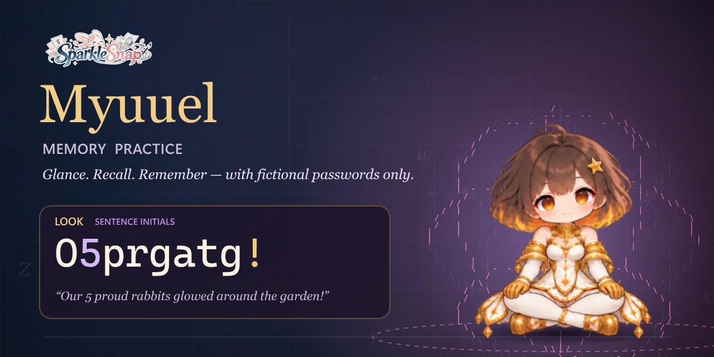

<div align="center">



# Myuuel Memory Practice

**A memory training app for your desktop. Practise remembering strong passwords — with fictional ones only.**

[](../../releases/latest)
&nbsp;
[](../../issues/new/choose)
&nbsp;
[](https://sparklesnap.dev/)

<sub>Memory training&nbsp;·&nbsp;Windows&nbsp;·&nbsp;works offline&nbsp;·&nbsp;no account&nbsp;·&nbsp;no telemetry&nbsp;·&nbsp;made by SparkleSnap</sub>

</div>

> [!IMPORTANT]
> **Every combination you see is fictional.** They are generated at random on your own computer, held only in memory and thrown away when you close the app. They are not anyone’s passwords and were never meant to be — this is a learning tool for memory techniques. Don’t type your real passwords into it, and don’t adopt the examples you see as real passwords.

## What it is

**Myuuel Memory Practice is a free memory training app for Windows.** It is a calm, self-running slideshow that trains recall — the skill of holding something in mind and bringing it back — using password-style combinations as the motif. You glance at it while you work; it does the rest. Think of it as a small wellbeing gadget for your mind, in the same family as a breathing timer or a focus clock.

- **Recall practice, hands-free.** A combination appears, fades, waits while you rebuild it in your head, then comes back so you can compare. No typing, no scores, no streaks.
- **Real memory techniques.** Every combination is built with a mnemonic method — sentence initials, hidden words, rhymes, number stories — so you learn the technique, not just the string.
- **Made for a small vertical side screen.** The text is deliberately huge so you can read it from the corner of your eye on a little portrait display. It works on any monitor too.
- **A companion, not a dashboard.** Myuuel keeps you company: She breathes, reacts when you poke her, curls up when the app is paused and, if you leave her long enough, dozes off.

## How a round works

| | Phase | What happens |
|:-:|---|---|
| 👀 | **Look** | The combination and the memory method behind it are shown, very large. |
| 🌫️ | **Fade** | *(Fading Lantern mode)* Letters disappear in two steps. |
| 🧠 | **Recall** | Everything is hidden. Rebuild it in your mind. |
| ✨ | **Check** | It comes back so you can compare. Tap *Again* or *Comfortable* if you like. |
| 🍃 | **Rest** | A breath before the next one. |

Three combinations rotate at a time. Each one comes back for **three spaced rounds** (marked *round 2 of 3*, *round 3 of 3*) — seeing it again after a pause is what trains recall — then retires and a fresh one takes its place.

## Eight memory methods

Each combination is built with a technique, so you practise the *method* as well as the string.

| Method | Example | The trick |
|---|---|---|
| **Sentence initials** | `O5prgatg!` | *“Our 5 proud rabbits glowed around the garden!”* — keep first letters and numbers |
| **Hidden word** | `P8e=a2r8l` | PEARL, woven with a repeating `8 = 2` |
| **Mirror word** | `wodniW=Kite4` | WINDOW read backwards, then a second word |
| **Number story** | `Moon0050Boat!` | *“The moon boat sails at 00:50!”* |
| **Rhyme chain** | `Key*SeaTea74` | key, sea, tea — then the numbers |
| **Picture words** | `Iris=Dune76` | two images in a row |
| **Look-alike swap** | `H4rb0r-R053` | a→4, o→0, e→3, s→5 · a well-known trick, best combined with others |
| **Random string** | `+rKJ*7c5rhb` | read and recall it in chunks |

Difficulty (*Gentle · Standard · Tough*) changes the length and how many tricks are layered.

**How many are there?** Random strings have more than 500 trillion possibilities even on Gentle, so they practically never repeat. The method-built combinations add up to billions; each method has its own pool at every difficulty, and even the smallest one (Gentle number stories) holds about 2,900. Three are in play at a time, and new ones are invented as old ones retire. The words and scenes they are built on come from smaller hand-picked lists, so the app also keeps a short in-memory list of recently used ones and won't bring back a word like PEARL for about an hour of practice.

## See it in action


https://github.com/user-attachments/assets/4e1d9f8c-13ce-45a2-a943-9a78f500f23e


<sub>28 seconds of the real app: one practice round, Gentle and Tough, both themes (Living Type and Lantern Night), and Myuuel keeping you company. Music: “Myuuel, Solar Explorer (Trailer Version)” by SparkleSnap.</sub>

## Get started

**Download** the portable app from [**Releases**](../../releases/latest) and run it — nothing to install.

<details>
<summary><b>Run from source</b></summary>

Requires [Node.js](https://nodejs.org/) 20 or newer on Windows.

```bash
npm install
npm start
```

Or double-click `Start-Myuuel-Memory-Practice.cmd`. Build a portable `.exe` with `npm run dist:win`.
</details>

<details>
<summary><b>Is the download safe? Check it yourself</b></summary>

The `.exe` on the Releases page is not built on anyone’s PC. GitHub builds it from the code in this repository ([the workflow](.github/workflows/build-windows.yml)) and signs a **build-provenance attestation**: a public, tamper-proof record of which commit and which workflow produced that exact file.

- **See it:** the [Attestations](../../attestations) page of this repository.
- **Verify a download** with the [GitHub CLI](https://cli.github.com/):
  ```bash
  gh attestation verify Myuuel-Memory-Practice-Windows-x64.exe --repo cesarborgenkrans-gif/myuuel-memory-practice
  ```
- **Compare the checksum** with `SHA256SUMS.txt` from the same release: `Get-FileHash Myuuel-Memory-Practice-Windows-x64.exe` in PowerShell.

The app is not code-signed yet, so Windows SmartScreen may say it doesn’t recognise it. Choose *More info → Run anyway*, or build it yourself from source.
</details>

**Little things to try:** <kbd>Space</kbd> pauses · <kbd>M</kbd> switches mode · poke Myuuel · tap the sky · press and hold the card during *Recall* to peek. Got a small second screen? Choose **▣ → Side screen** once and she’ll open there every time.

## Coming next

- **Type to check** — an optional moment after Recall where you type what you remember and see whether it matched (still fictional, never stored).
- More memory methods and story worlds.

Right now it is a hands-free mind-practice slideshow, and that is on purpose: practice you can do without stopping what you are doing.

## Privacy

The app makes no network requests, has no account and collects nothing. Only your settings (theme, speed, difficulty…) are stored on your computer — never a combination. The one outside link is the SparkleSnap signature in Settings, which opens [sparklesnap.dev](https://sparklesnap.dev/) in your browser.

## Feedback

Ideas, bugs, a memory method you love? [**Open an issue**](../../issues/new/choose) — every note is read. If Myuuel helped you, a ⭐ helps others find her.

## Licence — what you can do

**Short version: the code is yours to use, and Myuuel is yours to adore and draw or remix, as long as you credit her home.**

| | Licence | In short |
|---|---|---|
| 💻 **Code** — `src/`, `tools/`, start scripts | [MIT](LICENSE) | Clone, learn from, modify, fork and share it freely. Keep the copyright notice. |
| 🌸 **Myuuel** — her design, art and animation (`assets/myuuel/`, `docs/media/`) | [Character guidelines](CHARACTER-GUIDELINES.md) | Free for fan works, forks and non-commercial projects with credit — *Myuuel © SparkleSnap — sparklesnap.dev*. Keep her kind, make clear it's fan-made, and ask before selling anything with her on it. |
| ✨ **SparkleSnap name and logos** (`assets/brand/`) | Not licensed | Use them only to credit or link back. A fork uses its own name and mark. |

### Good to know

- **Educational use.** The app teaches memory techniques. It is not a password manager, does not check or store passwords, and promises nothing about the security of any password you create. For real accounts, use a password manager and unique, randomly generated passwords. Any match between a generated combination and a real password is coincidence.
- **No warranty.** Provided “as is”, as the MIT licence says; SparkleSnap is not liable for any loss arising from its use.
- **Ideas are free.** Practising recall, or remembering with sentences and pictures, belongs to everyone. Build your own take.
- **Third-party software.** Built with [Electron](https://www.electronjs.org/) (MIT licence, © OpenJS Foundation and Electron contributors).

© 2026 SparkleSnap.

<div align="center"><sub>Made with care by <a href="https://sparklesnap.dev/">SparkleSnap</a>.</sub></div>
